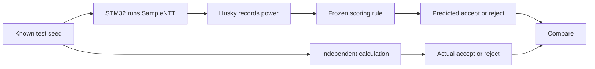

**The main finding is that we can predict an internal SampleNTT decision from the chip’s power trace—even with the fixed-loop implementation, where every recorded execution took the same amount of time.**

I’d build a roughly 30-minute explanation around how we reached that finding, why it makes sense, and how far the evidence goes.

For the first few minutes, I would establish what we were actually trying to learn.

ML-KEM contains a step called **SampleNTT** that turns a short input into a list of numbers used in its calculations. During that process, it generates candidate numbers and decides whether to keep or discard each one.

Our question was deliberately small:

> From one power recording, can we tell whether the **first candidate number** was kept or discarded?

We measured this using your STM32F4 target and ChipWhisperer Husky. We first tested the ordinary implementation, then the Fixed Loop Sampler, or **FLS**.

That gives the audience a concrete target. We are trying to recover one internal decision. Predicting that decision reliably establishes that the electrical measurements carry information about the computation. Turning that information into password or key recovery would require further work.

---

I would spend approximately minutes 3–7 explaining **why SampleNTT accepts some numbers and rejects others**.

For this discussion, the relevant output is a list of **256 numbers**, each between **0 and 3328**.

The input contains a short value called a *seed*. A function called SHAKE expands that seed into a long stream of bytes. The stream looks random, but it is repeatable: the same input produces the same stream.

SampleNTT reads that stream as candidate numbers between **0 and 4095**. It applies this rule:

| Candidate | Decision |
|---|---|
| 1200 | Accept |
| 3328 | Accept |
| 3329 | Reject |
| 3900 | Reject |

It continues until it has collected 256 acceptable numbers. This selection process is part of the standardized ML-KEM algorithm. [FIPS 203, Algorithm 7](https://nvlpubs.nist.gov/nistpubs/FIPS/NIST.FIPS.203.pdf)

Rejecting numbers may seem wasteful, but it preserves the intended distribution. Simply wrapping every oversized number back into the permitted range would give some output values more opportunities to occur than others.

An everyday description would be:

> Keep drawing numbers from a larger range, throw away the ones outside the permitted range, and stop when the list is full.

Because the stream is determined by the seed, we can independently calculate every candidate and every accept/reject decision. That gives the experiment an answer key.

The power classifier does **not** receive that answer key when making its test predictions.

We use it afterward to mark the predictions correct or incorrect.

---

Around minutes 7–11, I would explain **what the hardware records**.

Your STM32F4 performs the calculation. Husky records a voltage signal related to the target’s changing current consumption.

A recording of that signal over time is what we call a **power trace**.

The important physical idea is that executing a calculation involves changing electrical states inside the chip. Different instructions, different values, and different changes between values can produce different consumption patterns.

There is no simple rule that a larger number consumes more power. What matters includes which internal bits change and what the processor does with them.

Our setup makes those small changes easier to observe:

- Husky supplies the target clock, making the timing repeatable.
- A trigger marks the beginning of the measured computation.
- Husky records roughly four samples per target clock cycle.
- We keep the clock, amplification, firmware, and recording window consistent.

The trigger does not announce “accepted” or “rejected.” It marks the same overall operation for every input.

We also distinguish two measurements:

| Measurement | Information retained |
|---|---|
| Total execution time | How long the operation lasted |
| Power trace | How electrical activity changed during part of the operation |

Two operations can finish at the same time while having different activity along the way.

That distinction explains much of the ordinary SampleNTT result.

Before collecting useful traces, however, we had to find the right moment.

SampleNTT does substantial SHAKE work before it processes its first candidate. Recording near the beginning of the operation does not automatically capture the decision we care about. Our early, poorly located experiment performed close to chance.

The full-method notebook addresses this with a separate **calibration image**.

That image records when the first request for candidate bytes returns and when the next request begins. Processing of the first candidate pair happens between those boundaries.

We use those markers to choose an approximate recording window, then restore the ordinary measurement image.

This separation matters because adding measurement code can change the program’s timing and electrical behavior. **Calibration recordings are excluded from training and testing.**

The short A0 notebook reuses a previously validated window for its exact firmware image. The FLS notebook performs its own calibration because FLS has a different execution pattern.

---

For approximately minutes 11–15, I would explain **why the ordinary implementation leaks**.

The ordinary implementation, which the authors call **A0**, follows a direct approach:

> Generate a candidate. If it is acceptable, store it and advance the output position. Otherwise, continue without storing it.

Accepting a candidate therefore involves work that rejecting it can skip.

That can create a small local delay.

Our earlier calibration observed an accept/accept candidate pair taking **71 clock cycles**, while one reject/accept pair took **64 cycles**. The average recorded waveforms also became much more similar after accounting for a seven-cycle shift.

That agreement supports a local timing explanation, although it does not identify every instruction responsible.

Imagine looking at both recordings at exactly the same moment after the trigger. In one case, the processor has already reached a later instruction. In the other, it is still finishing earlier work.

The power readings at that moment can differ because the processor is doing different things.

A classifier can learn those differences.

This also explains why the whole-operation timing result can be weak while the power result is strong.

We deliberately selected inputs with the same overall sampling workload. In the A0 experiments, both classes processed the same number of candidate pairs and collected the same number of accepted values.

That makes the total work similar, while allowing the order of acceptances and rejections to differ.

The detailed power trace can reveal where activity happened within that operation. A single total-duration number loses that detail.

For A0, then, our strongest explanation is:

> The first decision changes the timing of subsequent activity, and the fixed-time power measurements reveal that change.

We should describe this as a power-trace distinguisher with evidence of local timing leakage. The weak total-duration baseline does not establish that A0 is constant-time.

---

Around minutes 15–19, I would introduce **what FLS changes**.

FLS is the authors’ **Algorithm A1**, the Fixed Loop Sampler. Our lab uses their pinned top-level implementation. Their repository also contains a different version for another embedded software framework, so identifying the exact implementation matters. [Authors’ artifact](https://github.com/afonsoarriaga/ProjectTempo)

FLS makes the execution schedule much more regular.

In our selected implementation:

- It always processes **280 pairs**, or **560 candidates**.
- It scans all 256 output positions for each candidate.
- It uses arithmetic to update the output position by zero or one.
- It continues its fixed work after the output list has filled.

There is a useful implementation detail here.

This particular FLS version tentatively writes a candidate at the current output position. If the candidate is invalid, the output position stays where it is, allowing the next candidate to overwrite that tentative value.

For illustration, suppose the second candidate is 1200 in both cases:

| First two candidates | What happens |
|---|---|
| 1000, then 1200 | Keep 1000, advance, then keep 1200 in the next position |
| 3500, then 1200 | Tentatively place 3500, stay at that position, then overwrite it with 1200 |

Both cases follow the fixed scanning schedule.

But the values inside the processor differ. The output position differs. The contents being read and written differ.

Those differences can affect power consumption even when the same instructions execute on the same schedule.

That gives us the FLS hypothesis:

> Fixing the execution schedule may remove the timing difference while leaving an electrical difference associated with the decision.

That was a hypothesis before the experiment. The recordings are what allow us to evaluate it.

The fixed scans also explain why this implementation is relatively slow on our target. It performs substantial work regardless of how quickly it has collected enough accepted values. The measured FLS operation lasts about **295 milliseconds** on this setup.

That duration is specific to this implementation and configuration; it is not a general speed figure for every FLS implementation.

---

For approximately minutes 19–23, I would walk through **how we turn recordings into a prediction without accidentally teaching the model the test answers**.

The FLS experiment uses:

| Group | Accepted first candidate | Rejected first candidate | Total |
|---|---:|---:|---:|
| Training | 128 | 128 | 256 |
| Fresh test | 128 | 128 | 256 |

Each seed has one model-data recording.

The seed groups are separate, and the test seeds have not appeared in earlier planned experiments.

We deliberately balance the classes. For ordinary uniformly generated 12-bit candidates, acceptance occurs about 81% of the time. An “always accept” rule could therefore look superficially successful if we only reported ordinary accuracy on an unbalanced dataset.

With equal class sizes, always guessing one answer gets only 50%.

We also require the second candidate to be valid and require the output to first fill at the same candidate position. These choices help control neighboring decisions and differences in the overall work.

They also restrict the population we are studying. Our reported percentage describes these deliberately selected inputs, rather than every possible naturally occurring input.

The input selection happens from mathematical properties **before examining their power recordings**. We do not choose inputs because their traces happen to be easy to classify.

For every recording, we independently calculate the expected polynomial output. The target returns a compact check value derived from its complete output, which we compare with the expected value.

That helps establish that the target performed the intended calculation correctly.

The classifier itself is a small weighted scoring rule.

It looks at a limited number of sample positions in the waveform. Some readings contribute toward “accept,” others toward “reject.” Their weighted contributions are added into one score.

For the FLS model:

> A score of zero or above predicts acceptance; a negative score predicts rejection.

The code calls this logistic regression. For our explanation, “a learned weighted scoring rule” captures what matters.

The sample positions and their weights come from the training recordings.

While choosing the window, we repeatedly divide training data into groups, learn using some groups, and check performance on another. The sample-point selection happens within those training divisions.

Even so, trying many windows can make the best training result look overly encouraging. That is why the notebook warns that its perfect development score is optimistic.

We then **freeze** the chosen window, sample positions, weights, and decision threshold.

Only afterward do we collect the fresh test.

For each test input, the process is:

The power model receives the waveform measurements. The seed and independently calculated answer are used to verify and grade the experiment.

This is also what **single-trace** means here: after calibration and training, each new test prediction uses one recording. Learning the scoring rule required many earlier examples.

---

Around minutes 23–27, I would put the results on screen.

The recent runs give us this picture:

| Experiment | Correct from one power trace | Accuracy | Total-duration baseline |
|---|---:|---:|---:|
| Full A0 method we discussed in section 13 | 252/256 | 98.44% | 56.25% |
| Short A0 lab | 255/256 | 99.61% | 52.73% |
| FLS lab | 250/256 | **97.66%** | **50.00%** |

These are separate runs with different seeds and experimental choices. They show repeated strong power discrimination. Their small percentage differences do not establish a precise ranking of the implementations’ resistance.

An earlier A0 run classified all 256 test seeds correctly. In the later full-method run, averaging two recordings per seed also produced 256/256 correct predictions. Those results belong in the record, with the distinction between one-capture and two-capture predictions preserved.

The FLS figure is especially informative:

On the **left**, the horizontal position is the classifier’s score.

The red recordings come from genuinely rejected candidates. The blue recordings come from genuinely accepted candidates. Most red scores lie below zero, and most blue scores lie above zero.

That separation is the visual evidence behind the high prediction accuracy.

A few recordings fall on the wrong side of the threshold. Some wrong predictions have substantial scores, so we should not describe every error as a barely distinguishable borderline case.

On the **right**, the prediction counts are:

| Actual decision | Predicted reject | Predicted accept |
|---|---:|---:|
| Reject | 124 | 4 |
| Accept | 2 | 126 |

There are six errors: four rejected candidates predicted accepted, and two accepted candidates predicted rejected.

We checked those recordings. Their labels, output verification, and ADC ranges passed. They remain part of the result.

The **middle plot** shows the total operation duration.

Every point lies on the same horizontal line because all **512 training and test recordings** have the same recorded duration:

**2,172,704 target clock cycles**, approximately **295.06 milliseconds**.

The separate calibration inputs also all took **7,236 cycles** for the first candidate pair, with four observations from each class.

This combination is the central FLS finding:

> The measured durations stayed fixed, while the power measurements still allowed accurate prediction.

We recorded only a short power window around the early candidate processing. The duration counter covered the entire operation. The flat duration result is therefore not a consequence of every waveform file having the same length.

I independently recalculated the recorded results. Both fitted models reproduced exactly. The training and test fingerprints matched their saved records, and every candidate stream and polynomial output passed an independent SHAKE calculation.

There were no FLS capture failures or retries. Amplification and recording settings were consistent, clipping checks stayed enabled, and none of the saved waveforms hit the ADC limits.

Those checks support taking the observed result seriously.

---

I would use the next couple of minutes to explain **the statistics and the qualifications that affect how we present the work**.

The FLS result is **97.66% observed accuracy**, with conservative 95% bounds of approximately **92.62% to 99.59%**.

The bounds acknowledge that we tested a finite number of inputs. They cover uncertainty from those sampled inputs under the tested conditions; they do not account for moving to another board or recording session.

The **AUC of 0.991** measures how well the scores rank the two classes. Roughly speaking, an accepted input receives a higher score than a rejected input in about 99.1% of the test pairings.

That differs from accuracy, which depends on the fixed zero threshold.

The very small label-randomization result asks another question:

> If these fixed predictions had no relationship with the real decisions, how often would randomly reassigned answers match them this well?

The answer is extraordinarily rarely under that test. This supports an association between power predictions and the true decision. It is not a probability that the experiment is authentic or that a future attack will succeed.

There are also two lessons from the older notebook worth explaining honestly.

First, a perfect finite test does not establish perfect future performance. The older method sometimes printed an uncertainty interval of `[1, 1]` after getting every prediction right. Its resampling procedure could only draw from already-correct examples, so it could not express the possibility of unseen mistakes.

The newer method retains uncertainty even with a perfect result.

Second, the single model trained on shuffled labels was an imperfect control. It sometimes performed above chance—or learned an inverse relationship. A predictor that consistently gives the opposite answer can still contain useful information.

We therefore should not present that control as proof that everything except the intended signal had been eliminated. The FLS method uses the separate fixed-prediction test-label randomization check.

One physical limitation remains particularly relevant: the FLS model’s selected window reaches across the end of the first pair and into subsequent processing. Its predictions could use effects of changed counters or stored values that persist beyond the first comparison.

**We have demonstrated decision-related information in the trace. We have not isolated one instruction as its sole source.**

---

For the final minutes, I would connect this back to **Tempo and the security significance**.

Ordinary ML-KEM exposes the matrix seed as public information. Revealing something about that already-public seed through timing does not automatically reveal a secret.

The Tempo paper examines password-based protocols where the public key, including the seed, can instead be hidden under a password. In that setting, measured behavior can help an attacker check password guesses: derive an expected input from a guess, calculate its expected behavior, and compare it with the observation.

The paper explores constant-time sampling alternatives. Its Tempo protocol also takes a separate approach: it transmits the seed openly, separating seed expansion from the password-dependent information. [Tempo paper](https://eprint.iacr.org/2025/1399)

Our experiment concerns the electrical behavior of the selected sampler implementation. It does not establish that the Tempo protocol has been broken.

Likewise, the fixed duration measurements are encouraging evidence about the intended execution schedule. Establishing constant-time behavior for every relevant input and hardware condition requires a broader argument than observing equal durations in this dataset.

The practical next step would be to keep this FLS classifier completely frozen, start another recording session, and test newly declared seeds. That would examine whether the learned pattern survives reconnecting and repeating the setup.

Further experiments could examine ordinary input distributions, other candidate positions, and the specific operations producing the signal. Each new model developed from those investigations would need its own untouched final test.

The statement I would put beside the final figure is:

> **On our STM32F4 setup, a classifier trained on power recordings predicted the first FLS SampleNTT candidate’s accept/reject decision correctly for 250 of 256 fresh inputs using one recording each. All recorded whole-operation durations were identical. This demonstrates decision-related power leakage in the tested fixed-loop implementation, with the physical cause and broader attack consequences still to be established.**